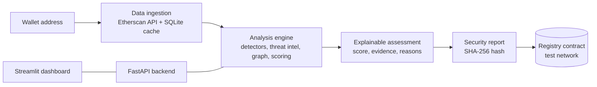

# 🛡️ ChainShield

**Explainable wallet risk analysis with tamper-evident security reports.**

*Team Forty_One · Cybersecurity track*

ChainShield checks an Ethereum address **before you send it money**. It returns a Low / Medium / High risk rating, the evidence behind every warning, a graph of connected wallets, and a security report whose SHA-256 hash can be anchored on a blockchain, so anyone can later prove the report was not altered.

> ChainShield doesn't just flag a wallet. It shows **why**, with evidence you can verify.

<!-- Add screenshots to docs/ and keep these lines, or delete them. -->


---

## Why this exists

Blockchain transactions are public but irreversible, and hard for ordinary people to read. Users can send funds to, or receive tokens from, scam or sanctioned addresses with no warning before they sign. Since a transaction cannot be reversed, **checking an address first is the best defence.**

**Who it is for**

- Everyday and first-time crypto users
- Small merchants and P2P traders doing quick due diligence
- Security analysts and students who need verifiable evidence

---

## Features

| Feature | What it does |
|---|---|
| **Risk rating** | Low / Medium / High with a 0-100 score and a plain verdict ("Do not transact with this address"). |
| **Threat-intel matching** | Checks the address, and everyone it transacted with, against the US OFAC sanctions list, known mixers, and curated malicious addresses. |
| **Pattern detection** | Flags rapid pass-through of funds, bursts of activity from a new wallet, and mixer exposure. |
| **Explainable results** | Every warning shows its severity, points, reason and the transactions behind it. No black box. |
| **Connection graph** | Shows connected wallets, with flagged ones highlighted. |
| **Tamper-evident reports** | Each report is hashed with SHA-256. The hash and a timestamp are stored in a Solidity contract on a test network. Re-hashing a report later reveals any change. |
| **Built for failure** | Cached lookups in SQLite, stale-cache fallback when the data provider fails, input validation, and a demo mode that works offline. |

---

## How it works



1. **Data ingestion** reads an address's transactions from the Etherscan API and caches them in SQLite.
2. The **analysis engine** matches threat indicators, runs the pattern detectors, builds the wallet graph and computes the score. Every triggered indicator keeps its evidence.
3. A **FastAPI backend** exposes analyze, report, anchor and verify endpoints.
4. The **Streamlit dashboard** shows the rating, evidence, graph and report tools.
5. A **Solidity registry contract**, called through web3.py, stores each anchored report hash with a timestamp. Only the hash goes on-chain, never the report.

### Scoring

Scoring is rule-based and deterministic: the same data always gives the same result. Each triggered indicator adds weighted points, the total is capped at 100, and every weight lives in `config.py`.

| Indicator | Points | Severity |
|---|---|---|
| The address itself is on the OFAC sanctions list | 100 | High |
| The address itself is a known malicious address | 90 | High |
| The address itself is a known mixing service | 70 | High |
| Direct contact with a sanctioned address | 80 | High |
| Direct contact with a known malicious address | 75 | High |
| Mixer exposure | 40 | Medium |
| Rapid pass-through (at least 80% of a received amount forwarded within 1 hour) | 25 | Medium |
| New-wallet burst (10+ transactions within 2 hours of first activity, on a wallet active 7 days or less) | 15 | Low |

**Rating bands:** Low 0-39 · Medium 40-69 · High 70-100

---

## Tamper-evident reporting

1. ChainShield builds a report: address, score, rating, findings with evidence, and recommendations.
2. The report is written in a canonical form (sorted keys, no extra whitespace) and hashed with **SHA-256**.
3. The hash and a timestamp are stored by the `ReportRegistry` smart contract. A hash can be anchored only once, so the original timestamp cannot be overwritten.
4. To verify, anyone re-hashes a report and looks the hash up on-chain. A match proves the report is unchanged since it was anchored. No match means it was altered, or never anchored.

The report itself is never sent to the blockchain. Only its 64-character fingerprint is.

---

## Tech stack

| Layer | Technology | Role |
|---|---|---|
| Backend API | Python, FastAPI | Analyze, report, anchor and verify endpoints |
| Analysis engine | Python, pandas, NetworkX | Pattern detection, indicator matching, scoring, wallet graph |
| Dashboard | Streamlit, Plotly | Search, risk rating, evidence view, connection graph, report tools |
| Chain data | Etherscan API (V2) | Transactions (read-only) |
| Storage | SQLite + threat-indicator dataset | Cached lookups, known indicators |
| Evidence anchoring | web3.py + Solidity registry contract | Stores the report hash and timestamp on an Ethereum test network |

---

## Project structure

```text
Chainshield_Main/
├── app.py                    # Streamlit dashboard
├── api.py                    # FastAPI backend
├── risk_engine.py            # Detectors, scoring, findings, graph data
├── config.py                 # Weights, thresholds, rating bands
├── service.py                # Fetch -> analyze pipeline used by the app and API
├── blockchain.py             # Etherscan client with caching and fallback
├── database.py               # SQLite cache and threat-indicator table
├── report.py                 # Report building, SHA-256 hashing, verification
├── chain.py                  # web3.py: anchor and look up report hashes
├── deploy_registry.py        # One-time contract deployment script
├── build_threat_list.py      # Builds the merged threat-indicator list
├── contracts/
│   └── ReportRegistry.sol    # Solidity registry contract
├── data/
│   ├── raw/                  # OFAC list, mixers, malicious addresses
│   ├── demo_indicators.csv   # Synthetic entries used by tests and demos
│   └── threat_indicators.csv # Generated merged list (do not edit by hand)
├── test_risk_engine.py       # Engine tests
├── test_blockchain.py        # Data-layer tests (offline)
├── test_api.py               # API tests
├── test_chain.py             # Chain helper tests
└── requirements.txt
```

---

## Getting started

### Prerequisites

- Python 3.10 or newer
- Git
- A free [Etherscan API key](https://etherscan.io/apis)
- For on-chain anchoring: a **throwaway** test wallet funded from a faucet (see below)

### 1. Install

```bash
git clone <your-repo-url>
cd Chainshield_Main

python -m venv venv
# Windows (PowerShell):
venv\Scripts\Activate.ps1
# macOS / Linux:
source venv/bin/activate

python -m pip install -r requirements.txt
```

### 2. Configure `.env`

Create a file named `.env` in the project root. It is listed in `.gitignore`. **Never commit it.**

```env
ETHERSCAN_API_KEY=your_etherscan_key

# Needed only for on-chain anchoring and verification
TESTNET_RPC_URL=https://ethereum-sepolia-rpc.publicnode.com
TESTNET_PRIVATE_KEY=0x...64 hex characters...   # throwaway test wallet only
CHAIN_ID=11155111
REGISTRY_ADDRESS=0x...                          # printed by deploy_registry.py
```

The analysis works with only `ETHERSCAN_API_KEY`. Without the blockchain settings, the anchor and verify buttons are disabled.

### 3. Build the threat list

Download the OFAC Ethereum list (`sanctioned_addresses_ETH.txt`) from the `lists` branch of
[0xB10C/ofac-sanctioned-digital-currency-addresses](https://github.com/0xB10C/ofac-sanctioned-digital-currency-addresses/tree/lists)
into `data/raw/`, then run:

```bash
python build_threat_list.py
```

The list is a snapshot. Rerun this step to refresh it.

### 4. (Optional) Deploy the registry contract

Create a new wallet that holds **no real funds**, request free test ETH for its address from a faucet for your chosen test network, put its key in `.env`, then:

```bash
python deploy_registry.py
```

Copy the printed `REGISTRY_ADDRESS=...` line into `.env`.

### 5. Run

Use two terminals, both with the virtual environment active:

```bash
# Terminal 1: API
uvicorn api:app --reload

# Terminal 2: dashboard
python -m streamlit run app.py
```

Open the address Streamlit prints (usually http://localhost:8501). The sidebar should show **API: Online**. If the API is not running, the dashboard falls back to calling the engine directly.

API documentation is generated automatically at http://127.0.0.1:8000/docs.

### 6. Run the tests

```bash
python -m pytest -v
```

The tests need no internet connection or API key.

---

## API

| Method | Endpoint | Purpose |
|---|---|---|
| GET | `/health` | Liveness check |
| GET | `/chain/status` | Blockchain configuration status (never exposes the key) |
| POST | `/analyze` | Full risk analysis for an address |
| POST | `/report` | Analyze and return the report with its SHA-256 hash |
| POST | `/anchor` | Hash a report and store the hash on the test network |
| POST | `/verify` | Re-hash a report; optionally compare with an expected hash and look it up on-chain |

---

## Demo walkthrough

1. **Risky address.** Analyze an address from the OFAC list. The verdict turns red and the Evidence tab lists every finding with its reason.
2. **Normal address.** Analyze an ordinary wallet and see it rated Low.
3. **Anchor.** In the Report tab, click **Anchor on-chain** and open the transaction on the block explorer.
4. **Verify.** Click **Verify on-chain** for the report: *Verified*.
5. **Tamper test.** Paste the downloaded report into the verification box, change a value such as the score, and verify again: *Not verified*.

---

## Security and privacy

- **Read-only analysis.** ChainShield uses only public blockchain data. Analysis needs no wallet and no keys.
- **Test networks only.** Anchoring accepts an allowlist of test networks. The code refuses to run if the RPC endpoint reports any other chain ID, so a mainnet endpoint can never be used by mistake.
- **Throwaway key.** The anchoring key belongs to a worthless test wallet and is stored only in `.env`, which is excluded from Git.
- **Only hashes go on-chain.** Reports stay with their owner.

---

## Limitations

- Risk ratings are **indicators, not proof of fraud**. A mixer contact, for example, is a risk signal, not a verdict.
- The sanctions list is a **dated snapshot** and covers sanctioned addresses, not every scammer. Tornado Cash was removed from the OFAC sanctions list in March 2025, so it is treated as a **mixer exposure** indicator rather than a sanction.
- On the free Etherscan tier, only the **latest 1,000 transactions** per address are analyzed. The dashboard tells the user when results are truncated, and the new-wallet-burst detector is less reliable on very active wallets.
- Analysis currently covers **Ethereum mainnet**.
- Report anchoring runs on a **test network**, which can change or be retired. Chain settings are configurable through `.env`.
- Weights are hand-set and tuned on a small set of demo addresses. They are not statistically validated.

---

## Roadmap

- Contract signals: unverified source code and very recent deployment
- Token-transfer analysis
- Indirect exposure (wallets two hops from a flagged address)
- Browser-extension warnings that call the ChainShield API before a user signs
- Multi-chain support
- ML anomaly detection as a separate, clearly labelled signal beside the rule-based score

---

## Data sources

- Transactions: [Etherscan API](https://docs.etherscan.io/)
- Sanctions: US Treasury OFAC SDN list, via [0xB10C/ofac-sanctioned-digital-currency-addresses](https://github.com/0xB10C/ofac-sanctioned-digital-currency-addresses)
- Mixers and malicious addresses: hand-curated entries in `data/raw/`

---

## Team Forty_One

Arav Hegde · Aditya Raj · Neelesh Panwar · Aryan

Cybersecurity track.

## License

Released under the MIT License. Add a `LICENSE` file to the repository root before publishing.
